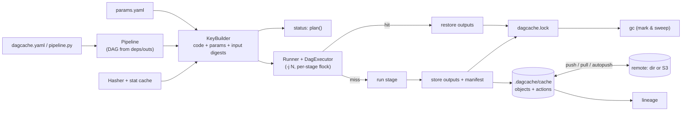

# dagcache

**A content-addressed, cached, parallel pipeline runner for reproducible ML workflows**,
in the spirit of DVC and Bazel. You declare stages (in YAML or with Python decorators),
and dagcache hashes each stage's code, parameters and input data into a cache key. It
then runs only what changed, restores everything else from a local or S3 cache, and
can tell you why a stage is stale and what produced any artifact.

```text
$ dagcache status                         # after editing train.C in params.yaml
load       up-to-date
...
train      stale       param train.C changed: 1.0 → 0.05
evaluate   pending     upstream stage 'train' is stale
```

## Who it is for

ML engineers and data scientists whose pipeline is a handful to a few hundred
scripts (load → split → featurize → train → evaluate) and who want:

* no recomputation after a revert, a branch switch, or a fresh clone (results come
  from a shared cache);
* an honest answer to "is this model stale, and why?";
* provenance for every artifact: which code, which params, which data;
* local-first operation: a single `pip install`, no server, and optionally S3.

It is a portfolio-scale implementation (about 4,600 lines of typed Python), not a
replacement for DVC in production. The [Limitations](#limitations) section says
where it falls short.

## Features

| | |
|---|---|
| **Stages** | shell commands in `dagcache.yaml`, or Python functions with `@pipeline.stage(...)`; the DAG is inferred from `deps`/`outs` (files or directories) |
| **Cache keys** | SHA-256 over code, declared params, input content, output declaration, declared env vars, and a salt. See [docs/HASHING.md](docs/HASHING.md) |
| **Code hashing** | `.py` files and functions hashed by normalised AST, so comments and formatting are ignored. Decorated functions include, transitively, the local helpers and constants they reference and the versions of the libraries they use |
| **Transitive invalidation + early cutoff** | a change propagates downstream through *content*, so an upstream that re-runs but writes identical bytes stops the cascade |
| **Caches** | local content-addressed store; remote on a shared directory or any S3-compatible service; `push`/`pull`/`autopush`; copy or hard-link restore |
| **Parallelism** | independent stages run concurrently (`-j N`), bounded, fail-fast or `--keep-going` |
| **Concurrency safety** | `flock`-based repo/stage/lock-file locks: concurrent `repro` processes run each stage once; `gc` waits for runs |
| **status** | per-stage state (`up-to-date`, `cached`, `stale`, `pending`, `always-run`, `error`) plus the reason: which param, file, function, library or dependency changed |
| **lineage** | trace any artifact back to source data, as a text tree, JSON, mermaid or DOT |
| **gc** | mark-and-sweep from the lock file (+ extra lock files, + recently used) |
| **Integrity** | every object verified on write and read; manifests self-verify; `cache verify` |

## Architecture



Each stage execution writes an **action manifest**, addressed by its cache key.
The manifest records the key components, the content digests of the outputs,
and the keys of the upstream producers. `dagcache.lock` (committed with your
code) holds the current manifest for each stage. Details, algorithms and
complexity are in [docs/ARCHITECTURE.md](docs/ARCHITECTURE.md).

## Quickstart

Requires Python 3.12 and [uv](https://docs.astral.sh/uv/) on Linux or macOS.

```bash
git clone <this repo> dagcache && cd dagcache
make check      # format, lint, mypy --strict, 161 tests + coverage gate
make demo       # the walkthrough below, offline, in build/demo/
```

A pipeline in YAML (`examples/wine/dagcache.yaml`, abridged):

```yaml
params: params.yaml
stages:
  split:
    cmd: >-
      python src/split.py --data data/raw.csv --out-dir data/split
      --test-size ${split.test_size} --seed ${split.seed}
    code: [src/split.py, src/common.py]
    deps: [data/raw.csv]
    outs: [data/split/train.csv, data/split/test.csv]
  train:
    cmd: python src/train.py --features data/features --out models/model.pkl --C ${train.C}
    code: [src/train.py]
    deps: [data/features]          # a directory output of `featurize`
    outs: [models/model.pkl]
```

The same idea with decorators (`examples/decorators/pipeline.py`):

```python
from dagcache import Pipeline, StageContext
from helpers import zscore            # a local module: edits to it invalidate `normalize`

pipeline = Pipeline("decorators")

@pipeline.stage(deps=["data/samples.json"], outs=["data/normalized.json"])
def normalize(ctx: StageContext) -> None:
    values = json.loads(ctx.path("data/samples.json").read_text())
    ctx.path("data/normalized.json").write_text(json.dumps(zscore(values)))
```

Commands:

```bash
dagcache repro [STAGE...] [-j N] [--force] [--keep-going] [--dry-run]
dagcache status [--json] [--check]      # --check: exit 1 if anything needs work (CI)
dagcache dag [--format text|mermaid|dot] [--status]
dagcache lineage PATH [--format text|json|mermaid|dot]
dagcache gc [--dry-run] [--keep-days N] [--keep-lock OTHER.lock] [--remote]
dagcache push|pull [STAGE...]
dagcache cache stats|verify
dagcache -f pipeline.py:pipeline <command>   # Python-defined pipelines
```

Remote cache: set `cache.remote: s3://bucket/prefix` (plus `cache.s3.endpoint_url`
for MinIO/SeaweedFS/R2) or a directory path, or export `DAGCACHE_REMOTE`. S3 needs
`pip install 'dagcache[s3]'` and the standard AWS credential chain. See `.env.example`.

## Demo

Output of `make demo`, pasted from a real run (some sections trimmed, marked `...`).
The pipeline is a scikit-learn classifier on the UCI Wine data bundled with
scikit-learn (see [DATA.md](DATA.md)):

```text
=== 3. First run (4 parallel workers): everything runs ====================
$ dagcache repro -j 4
repro: 7 stage(s), jobs=4
  | load: wrote 178 rows x 13 features to data/raw.csv
  ran        load              1.16s  6d5f61c530  (never run)
  ...
  | evaluate: held-out metrics: {'accuracy': 0.963, 'macro_f1': 0.9619, 'n_test': 54}
  ran        evaluate          0.79s  692f1d80cc  (never run)
done in 4.38s: 7 ran, 0 restored, 0 up-to-date, 0 failed, 0 not run (max parallel 2)

=== 4. Second run: nothing to do ==========================================
$ dagcache repro
...
done in 0.01s: 0 ran, 0 restored, 7 up-to-date, 0 failed, 0 not run (max parallel 2)

=== 5. Change a hyper-parameter: only train + evaluate are stale ==========
# edit wine/params.yaml: 'C: 1.0' -> 'C: 0.05'
$ dagcache status
load       up-to-date
profile    up-to-date
split      up-to-date
featurize  up-to-date
train      stale       param train.C changed: 1.0 → 0.05
baseline   up-to-date
evaluate   pending     upstream stage 'train' is stale
2 of 7 stage(s) need work

=== 6. Revert it: results come back from the cache, nothing recomputes ====
# edit wine/params.yaml: 'C: 0.05' -> 'C: 1.0'
$ dagcache repro --no-output
  ...
  restored   train             0.00s  2e986e92ee  (param train.C changed: 0.05 → 1.0)
  restored   evaluate          0.00s  692f1d80cc  (dependency models/model.pkl changed (0057f627 → 4219e2bf))
done in 0.01s: 0 ran, 2 restored, 5 up-to-date, 0 failed, 0 not run (max parallel 2)

=== 7. Comment-only code edit and an unused param: still up to date =======
...
0 of 7 stage(s) need work

=== 8. Early cutoff: load re-runs but writes identical bytes ==============
# edit wine/src/load.py: 'print(f"wrote' -> 'print(f"exported'
$ dagcache repro --no-output
  ran        load              0.74s  86602c67ca  (code file src/load.py changed (fffd8f5b → e304ad0b))
  up-to-date profile                  5fb5fdde62
  ...
done in 0.81s: 1 ran, 0 restored, 6 up-to-date, 0 failed, 0 not run (max parallel 2)

=== 9. Lineage of the metrics file ========================================
$ dagcache lineage metrics/metrics.json
metrics/metrics.json  @8e9b581d47
  ⮑ stage evaluate  key 692f1d80cc  at 2026-10-25T12:30:27+00:00
     cmd: python src/evaluate.py --features data/features --model models/model.pkl --out metrics/metrics.json
     code: src/evaluate.py@748c0a6e
  ├── data/features  @a45f8e3312
  │     ⮑ stage featurize  key 57cb37d3ef  at 2026-10-25T12:30:25+00:00
  │        params: features.scaler="standard"
  │     ├── data/split/test.csv  @f4e1d38ebf
  │     │     ⮑ stage split  key 07820c09d2  at 2026-10-25T12:30:24+00:00
  │     │        params: split.seed=7, split.test_size=0.3
  │     │     └── data/raw.csv  @bbb5d1482d
  │     │           ⮑ stage load  key 86602c67ca  at 2026-10-25T12:30:30+00:00
  ...
  └── models/model.pkl  @4219e2bf96
        ⮑ stage train  key 2e986e92ee  at 2026-10-25T12:30:26+00:00
           params: train.C=1.0, train.max_iter=500
  ...

=== 12. Share through a remote: a fresh clone runs nothing ================
$ dagcache push
pushed 7 action(s), 11 new object(s) (45.5 KiB) to ../shared-remote
# cloned pipeline + params + lock file + src (no data, no cache)
$ dagcache repro --no-output
  ...
done in 0.08s: 0 ran, 7 restored, 0 up-to-date, 0 failed, 0 not run (max parallel 2)

=== 13. Two concurrent runs on a cold workspace share the work ============
[process 1] exit 0: done in 3.99s: 0 ran, 0 restored, 7 up-to-date, 0 failed, 0 not run (max parallel 2)
[process 2] exit 0: done in 3.97s: 7 ran, 0 restored, 0 up-to-date, 0 failed, 0 not run (max parallel 2)
stage executions across both processes: 7 (pipeline has 7 stages)

=== 14. Python-decorator pipeline: function-level code hashing ============
# edit decorators/helpers.py: 'sd = statistics.pstdev(values) or 1.0' -> 'sd = statistics.pstdev(values) or 1e-9'
$ dagcache -f pipeline.py status
generate   up-to-date
normalize  stale       function helpers.zscore changed (749a30ba → c7930593)
summarize  pending     upstream stage 'normalize' is stale
$ dagcache -f pipeline.py repro
  up-to-date generate                 ecd9c05e3e
  ran        normalize         0.00s  91d9045d2f  (function helpers.zscore changed (749a30ba → c7930593))
  up-to-date summarize                f92a3556fb
```

In the last step `summarize` stays up to date although its upstream re-ran: the
helper change does not alter the normalised output (no sample has zero spread),
so early cutoff stops the cascade.

The held-out accuracy (0.963 at `C=1.0`, 1.0 at `C=0.05`, majority baseline 0.389)
is measured on a 54-row stratified test split that no stage fits on. The dataset
is tiny, so treat these numbers as a smoke test of the pipeline, not as a model
result. The demo changes `C` to show caching, not to choose a model.

## Design decisions

The full list, with costs, is in [DECISIONS.md](DECISIONS.md). The ones that shape
behaviour:

* **Content, not upstream keys, flows downstream.** This gives early cutoff. The
  price is that `status` reports `pending` (not `stale`) for stages behind one that
  must run, because their inputs are unknown until it runs.
* **Command templates are keyed, not expanded commands.** A param change then
  reads as a param change, not as "command changed".
* **AST-normalised code hashing.** Reformatting, comments and decorator arguments
  never trigger re-runs. Docstrings and library upgrades do.
* **Locks, not a daemon.** Three `flock` levels and a re-check under the stage
  lock make concurrent `repro` runs safe without a server process.
* **JSON lock file.** The first YAML version spent about 33 s of a 100-stage run
  in the YAML parser (cProfile); JSON with memoised reads brought that run to
  about 0.9 s.
* **The remote is optional and failures degrade.** Lookup errors count as misses,
  and autopush errors are warnings with a hint to run `dagcache push`.

## Tests, coverage and benchmarks

Every number below was produced by the command next to it, on the development
machine (macOS arm64, 8 cores, Python 3.12.13).

| what | command | result |
|---|---|---|
| full gate | `make check` | ruff format + lint clean, `mypy --strict` clean, **161 passed** (2 integration tests deselected) |
| coverage (line + branch, `src/dagcache`) | `make check` (`pytest --cov`, gate `fail_under = 85`) | **95.07 %** |
| real S3 server | `make integration` (SeaweedFS 3.97 in Docker) | 2 passed |
| source size | `wc -l src/dagcache/*.py src/dagcache/backends/*.py` | 4,585 lines (tests: 2,539) |

The tests include property tests (Hypothesis: canonical-JSON order independence,
tree-digest order independence, scheduler correctness on random DAGs, topological
order). There is a multi-process test in which three `repro` processes race on a
cold workspace and every stage must run exactly once, a backend contract suite
that runs against both the filesystem store and S3 (moto), and an end-to-end test
of the scikit-learn example.

`make bench` (synthetic workloads generated by `bench/bench.py`):

| benchmark | result | detail |
|---|---|---|
| SHA-256, 256 MiB file, no stat cache (in page cache) | 2.04 GB/s | (0.132s) |
| same file, stat-cache hit | 12 µs | per lookup |
| first run, 300-stage DAG (trivial stages) | 1.67 s | (5.6 ms/stage) |
| no-op repro, 300 stages | 0.20 s | (0.66 ms/stage) |
| status, 300 stages | 0.06 s | (0.19 ms/stage) |
| 8 independent 0.5 s stages, jobs=1 | 4.30 s | (max parallel 1) |
| 8 independent 0.5 s stages, jobs=4 | 1.17 s | (max parallel 4) |
| 8 independent 0.5 s stages, jobs=8 | 0.76 s | (max parallel 8) |

Machine load varies (other jobs were running), so treat these as orders of
magnitude. The "first run" row measures dagcache's per-stage overhead (hashing,
storing, manifest and lock-file writes) with stages that do almost nothing.

## Limitations

* **Undeclared inputs are invisible.** If a script reads a file that is not in
  `deps` or `code`, changes to it do not invalidate anything. There is no
  sandboxing or syscall tracing (Bazel sandboxes, and some tools trace syscalls).
* **POSIX only.** Locking uses `flock`, so Windows is not supported, and `flock` on
  NFS is unreliable. Use a local disk for `.dagcache/`, and use a directory remote
  on NFS only for push/pull.
* **Concurrent runs with different inputs in one workspace are not isolated.**
  Concurrent runs of the *same* state are safe and share work. Two people running
  *different* params in the same checkout at the same time can race on outputs.
* **Python stages share the GIL.** Decorated pure-Python stages do not speed up
  with `-j` (command stages and NumPy/scikit-learn code do).
* **Python fingerprints are heuristic.** They follow references to local
  functions, classes, modules and constants, and record library versions.
  Behaviour driven by an object's runtime state, dynamic imports, or `getattr`
  strings is not seen. The `salt` field is the escape hatch.
* **Env var digests are unsalted SHA-256** in a committed lock file. Do not track
  low-entropy secrets.
* **Remote GC is not coordinated across machines.** `gc --remote` uses the local
  lock file as roots and can delete objects a teammate just pushed. It is
  opt-in.
* **Lock-file writes are O(stages) each**, so a full run writes O(V²) bytes. That
  is fine to a few thousand stages but would need batching beyond that.
* **Validation scope.** The S3 backend is unit-tested against moto and
  integration-tested against SeaweedFS, not against AWS S3 itself. CI is defined
  in `.github/workflows/ci.yml` but has not run (the repository has not been
  pushed). Nothing here has been used in production.
* **Small example.** The ML example uses a 178-row dataset, so its metrics say
  nothing about modelling.

## Roadmap

* Batch lock-file writes, and a SQLite-backed lock index for very large DAGs.
* Optional sandboxed execution (read-only inputs, private temp dirs) to catch
  undeclared dependencies.
* `foreach`/matrix stages for parameter sweeps, each cached separately.
* Leases for coordinated GC on shared remotes; GCS/Azure backends.
* Process-pool execution for CPU-bound Python stages.

## Repository layout

```
src/dagcache/        library + CLI (typed, mypy --strict)
  backends/          filesystem and S3 stores
tests/               161 tests (unit, property, multi-process, end-to-end), integration/
examples/wine/       scikit-learn pipeline in YAML
examples/decorators/ the same ideas with Python decorators
scripts/demo.py      `make demo`;  scripts/integration.sh  `make integration`
bench/bench.py       `make bench`
docs/                ARCHITECTURE.md, HASHING.md
```

License: MIT (see [LICENSE](LICENSE)).
