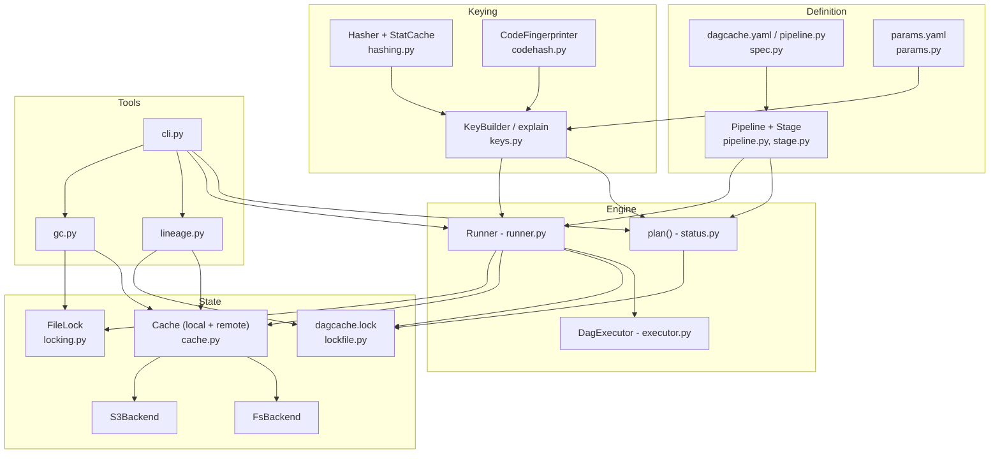

# Architecture

dagcache is a library with a thin CLI. A run goes through five layers:



| module | responsibility |
|---|---|
| `paths.py` | workspace-relative path normalisation; containment/overlap tests |
| `canonical.py` | canonical JSON and digest helpers |
| `hashing.py` | file and tree digests; SQLite stat cache with git's racy-file rule |
| `codehash.py` | AST-normalised code fingerprints with transitive closure |
| `params.py` | params files, dotted keys, `${...}` interpolation |
| `stage.py`, `pipeline.py` | stage model; DAG inferred from deps/outs; validation; topological order |
| `spec.py`, `workspace.py` | `dagcache.yaml` / Python loading, config, env overrides, state directory |
| `manifest.py` | `KeyComponents`, `OutputRecord`, `ActionManifest` |
| `keys.py` | building key components; diffing them into human-readable reasons |
| `backends/` | content-addressed stores: filesystem and S3 |
| `cache.py` | layered local + remote cache; store/restore outputs; push/pull |
| `lockfile.py` | `dagcache.lock` read-modify-write under a mutex |
| `locking.py` | `flock`-based shared/exclusive file locks with timeouts |
| `status.py` | planning without running: state + reasons per stage |
| `executor.py` | generic bounded-parallel DAG executor |
| `runner.py` | `repro`: per-stage decide/restore/run, under per-stage locks |
| `lineage.py` | provenance graph from manifests; text/JSON/mermaid/DOT renderers |
| `gc.py` | mark-and-sweep over local or remote store |
| `cli.py` | argparse front-end, exit codes |

## Data model

```
.dagcache/cache/
  objects/ab/cdef...        immutable blobs: file contents and tree manifests
  actions/12/3456....json   ActionManifest, addressed by stage cache key
dagcache.lock               last successful ActionManifest per stage (committed)
```

* **Object**: content addressed. Writing one that exists is a no-op; it is
  written to `tmp/`, verified against its digest, made read-only (0444) and
  renamed into place.
* **Action manifest**: `{key, stage, components, outputs, upstream, created_at,
  duration_s}`. `outputs` lists `(path, kind, digest, size, executable)`;
  `upstream` maps each dependency produced by another stage to that producer's
  key, and those links are the edges of the lineage graph. Manifests are
  self-verifying: `components` must re-hash to `key`.
* **Lock file**: one manifest per stage, with `upstream` refreshed to the
  producers that are current in this workspace. It is the GC root set, and the
  answer to "what is in my workspace and why".

## Key algorithms

### Planning (`status`) - O(V + E) plus hashing

Walk stages in topological order. For each, resolve dependency digests:
workspace hash if the producer is up to date, the producer's manifest digest
if it is restorable, otherwise *unknown*, which makes the stage `pending`
(transitive invalidation). With all digests known, build the components and
key, then compare with the lock entry:

* same key and outputs intact → `up-to-date`
* key present in the cache → `cached` (restorable)
* otherwise → `stale`

In both of the last two cases the reasons come from `explain(old, new)`, which
diffs the two component sets field by field and names the param, file,
function or library that moved.

### Execution (`repro`) - Kahn's algorithm, event driven

`DagExecutor` keeps a ready heap (ordered by declaration order, so runs are
deterministic for `-j 1`), submits up to `jobs` nodes to a thread pool, and on
each completion decrements the in-degree of successors. A failed node marks
its descendants `skipped`. By default no new nodes start after a failure;
`--keep-going` lets unrelated branches finish. Work outside the user's
callable is O(V + E).

Per stage, inside `Runner._process_stage`:

1. hash dependencies (materialised by now) → components → key;
2. take `locks/stage-<name>.lock` exclusively;
3. re-read the lock file and decide: up-to-date / restore from cache
   (local, then remote) / run;
4. to run: delete declared outputs, execute (`/bin/sh -c` for commands, with
   output streamed to `.dagcache/logs/<stage>.log`; in-thread call for Python
   stages), check that every output exists, store outputs, write the manifest,
   merge the lock entry.

The stage runs in a thread for both kinds. Command stages are separate
processes, so they really run in parallel. Python stages share the GIL, so
they only overlap where they release it (NumPy, scikit-learn, I/O).

### Concurrency

Three lock levels, always taken in this order and never two at the same level:

| lock | mode | held by | protects |
|---|---|---|---|
| `repo.lock` | shared | `repro`, `push`, `pull` | the cache from GC |
| `repo.lock` | exclusive | `gc` | sweeping while nobody reads |
| `stage-<name>.lock` | exclusive | one process deciding/running a stage | double execution |
| `lockfile.lock` | exclusive | the lock-file RMW | lost updates |

Because the decision is re-made *after* acquiring the stage lock, a second
process blocked on it wakes up, sees the first one's lock entry (or cache
entry) and does not recompute. `flock` locks belong to an open file
description, so threads that open the lock file separately exclude each other
like processes do, and a crashed holder releases its locks. Object and
manifest writes are atomic renames, so readers never see partial data.
`tests/test_concurrency.py` runs three `repro` processes on a cold workspace
at once and asserts that every stage executed exactly once.

The SQLite stat cache is shared too. Its first-time `PRAGMA journal_mode=WAL`
is retried with backoff, because that statement takes a lock that SQLite's
busy timeout does not cover. A concurrent cold start in the demo exposed this.

### Restore

A file output is copied (default) or hard-linked (`cache.link: hardlink`;
objects are read-only, so a stage cannot corrupt the cache through the
link). A directory output is assembled in a sibling staging directory, then
swapped in with two renames, so a crash never leaves a half-restored tree
under the real name. The executable bit is restored from the tree manifest.

### Lineage - O(depth × fan-in) manifest reads

`trace(path)` hashes the artifact and finds its producer: first via the lock
file (exact output or a file inside a directory output), else by scanning
cached manifests for that digest (`matched by content`). Then it follows
`upstream` keys recursively. Lock entries win over cached manifests, because
after an early cutoff they point at the producer that is current *now*.
Stage nodes are memoised by key, so diamonds are rendered once and marked
"(inputs shown above)".

### Garbage collection - O(A + O)

Roots = lock-file keys ∪ extra lock files ∪ actions used in the last
`--keep-days` (last use = manifest mtime, touched on every hit). Mark every
object reachable from root manifests, reading tree manifests to reach their
files. Then sweep unmarked actions and objects, plus staging files older than
an hour. It runs under the exclusive repo lock.

## Complexity summary

| operation | cost |
|---|---|
| hash a file | O(size), ~1.7 GB/s on the dev machine (`make bench`) |
| re-check an unchanged file | one SQLite point lookup (~11 µs) |
| `status` | O(V + E) + hashing of changed inputs/outputs |
| `repro` scheduling | O(V + E) + lock-file updates; each update rewrites the JSON lock file, O(V), so O(V²) bytes written per full run (fine to a few thousand stages) |
| restore | O(total output size) copies, or O(files) hard links |
| `gc` | O(actions + objects) + tree reads |
| `lineage` | O(ancestors) manifest reads (+ O(actions) scan for content matches) |
